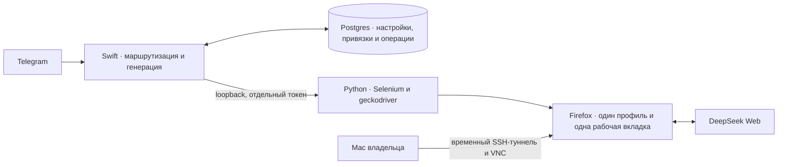

# Архитектура DeepSeek Web для Telegram-бота

DeepSeek Web добавляется как отдельный текстовый сервис `deepseek-web`. Один аккаунт, один постоянный профиль Firefox и один браузерный обработчик последовательно обслуживают весь бот. У каждой лички и каждого топика свой диалог в DeepSeek. В обычном ходе бот отправляет роль, текущий вопрос и новые реплики прослушки. Предыдущие ходы уже находятся в веб-диалоге.

**Статус решения.** Это проект интеграции. В Ai-news-bot уже работают вход с Mac и генерация в свежем чате. Для этого бота ещё предстоит подтвердить три вещи на стенде — продолжение именно нужного диалога, поведение реальных ролей и расход ресурсов полного контейнера. На Railway Free с отдельным томом PostgreSQL для профиля Firefox не хватит томов. Подробности и условия запуска приведены ниже.

Работа агентов распределена в [заданиях по внедрению](deepseek-web-agent-instructions.md). При реализации используй уточнения к контракту и приёмке из этого документа.

## Интеграция с ботом



- Используй существующие `ServiceProvider`, `ProviderGatewayRegistry` и доставку Telegram. Передавай в Web-адаптер отдельный тип запроса с `ChatKey`, идентификатором операции, снимком роли и вопроса, состоянием привязки и структурированным контекстом. Существующий `ProviderGenerationPlan.messages` уже теряет границы прослушки и текущего вопроса. [Порт провайдера](../Sources/LLM_chat_bot/Application/Ports/ProviderGatewayPort.swift) · [Координатор](../Sources/LLM_chat_bot/Application/Generation/GenerationCoordinator.swift)
- Регистрируй Web по флагу. Поддержи выбор через `/provider deepseek-web`, меню оператора и настройку провайдера по умолчанию для запуска только с Web. Список выбора и проверки при сохранении должны опираться на реестр. В режиме только с Web обязательны Telegram, Postgres и настройки браузерного обработчика. Ключи DeepSeek API и OpenRouter нужны при включении соответствующих адаптеров. Фоновые задачи OpenRouter запускаются только с его адаптером. Если сохранённый провайдер отключён, скажи об этом и предложи явно выбрать доступный. [AppConfig](../Sources/LLM_chat_bot/App/AppConfig.swift) · [AppAssembly](../Sources/LLM_chat_bot/App/AppAssembly.swift)
- Определяй Web до коммерческих проверок генерации. Веб-ход использует бесплатный браузерный тариф, занимает общий лимит аккаунта DeepSeek и обходится без списания из кошелька, премиум-квоты, проверки каталога OpenRouter и автоматического перехода на API. Применяй действующие права доступа и правила рекламы успешных ответов бесплатного тарифа. Дай пользователю своей лички и пользователю с действующими правами управления общим чатом в боте доступ к Web-ролям и прослушке через существующие команды и меню без платной подписки. [Монетизация](../Sources/LLM_chat_bot/Application/Generation/GenerationCoordinator+Monetization.swift) · [Доступ к прослушке](../Sources/LLM_chat_bot/Application/Commands/BotCommandHandler+Listen.swift)
- В браузерном режиме Web принимает текст и вложения. У Web свой отображаемый сервис. API-идентификатор модели, температура, точные токены и стоимость к веб-ходу неприменимы. Скрывай соответствующие настройки в веб-режиме. Параметры DeepThink и поиска задавай согласованным профилем браузерного обработчика и проверяй состояние UI перед отправкой. Стартовый вариант для замеров — обычный режим с выключенным поиском. DeepThink можно включить настройкой после проверки времени и квоты.

## Ключ диалога и состояние

Используй `ChatKey(chatID, threadID)` на входе из сообщения, кнопки и захвата реплик. Нынешнее значение `threadID` равно `message_thread_id ?? 0`. Проверь General, обычную группу и ответы в топике на реальных формах Telegram Update. Если General приходит в нескольких формах, нормализуй их в одном месте и передавай исходный идентификатор отдельно там, где его требует Telegram для доставки. Личка и топик используют один принцип изоляции. Смену владельца лицензии не используй как ключ. [Маршрутизация](../Sources/LLM_chat_bot/Application/BotOrchestrator+Routing.swift) · [ChatKey](../Sources/LLM_chat_bot/Domain/Chat/ChatSessionTypes.swift) · [Telegram Bot API](https://core.telegram.org/bots/api#message)

Одному `(accountEpoch, remoteChatID)` может соответствовать только один активный `ChatKey`. Обеспечь это частичным уникальным индексом по двум полям в JSONB-столбце `bot_chat_context.data` для строк с активной привязкой. Миграция ключа переносит владение в одной транзакции. Проверяй известный ID до отправки. Если сайт назначил конфликтующий ID только после первого клика, останови выдачу ответа и пометь операцию для сверки. Поиск по названию в боковой панели ненадёжен, названия у разных диалогов могут совпадать.

Храни состояние Web внутри строки `bot_chat_context` как необязательное версионированное поле. Для существующих строк оно пустое. Используй прежнее поле провайдера для сохранённого выбора API и добавь отдельный признак выбора Web, чтобы старый декодер мог прочитать строки. Эффективный `ServiceProvider` при включённом выборе — `.deepseekWeb`. Отдельно проверь обратный переход, поскольку старый бинарник использует сохранённый выбор API. Оперативный откат делай на совместимый билд с выключенным Web. [Снимки состояния](../Sources/LLM_chat_bot/Domain/Chat/PersistedSnapshots.swift) · [Импорт и экспорт](../Sources/LLM_chat_bot/Domain/Chat/ChatContextStore+Persistence.swift)

| Поле | Назначение |
| --- | --- |
| `accountEpoch` | Идентификатор экземпляра аккаунта для привязок. Повторный вход в тот же аккаунт его сохраняет. Подтверждённая владельцем смена аккаунта меняет его и делает старые привязки недействительными. |
| `contextEpoch` | Случайный UUID для текущего поколения памяти в `ChatKey`. Проверяется вместе с аккаунтом и операцией. Новый UUID при сбросе защищает и после удаления с последующим созданием строки. |
| `remoteChatID`, `remoteTail` | Канонический ID подтверждённого диалога или пустое значение. `remoteTail` описывает последнюю подтверждённую позицию, по которой обработчик сверяет историю перед отправкой. Предпочитай стабильные ID ходов, видимые в UI. Если их нет, сверяй последовательность с отпечатком нормализованной пары вопрос–ответ и её позицией. Совпадения одного текста или числа отрисованных элементов недостаточно. |
| Позиция прослушки | Нижняя граница разрешённой истории после очистки и позиция обработанных реплик в текущем веб-диалоге. Сохраняй точные ID нативных вопросов и доставленных ответов в пределах локального окна. |
| Локальное окно | Ограниченный хвост подтверждённых веб-вопросов и доставленных ответов с признаком участия прослушки, без копии роли и вставленной стенограммы. Нужен для `/history` и восстановления после ротации. Для Web `/historylength` управляет этим окном, а срок жизни веб-диалога регулирует отдельная политика. |
| Активная операция | `GenerationID`, стабильный источник Telegram, стадия, базовая позиция удалённого диалога и планируемая позиция реплик. Храни только необходимое для сверки. |

Критические записи проводи через подтверждаемый checkpoint в Postgres, сериализованный с существующим write-behind. Расширь `PersistenceCoordinator` checkpoint для строки и ревизии через его цепочку записи, включая подтверждение удаления строки. `flushNow()` сейчас возвращает `Void` и скрывает ошибки. Перед кликом подтверди намерение, перед доставкой — удалённый результат, перед ответом об очистке — сброс или удаление. Сверяй ревизию после `await`. При ошибке записи приостанови отправку из затронутого контекста до восстановления. В режиме без Postgres разрешай сценарии на имитаторе, а эксплуатационный Web должен сообщать о недоступности. [PersistenceCoordinator](../Sources/LLM_chat_bot/Application/Persistence/PersistenceCoordinator.swift)

Передавай исходный Telegram `update_id` от webhook или polling до обработки сообщения и кнопки примера. Проверяй ранее принятый ID до создания контекста, записи реплики и отправки эха кнопки. При допуске **одной транзакцией** запиши уникальную отметку и ожидающую операцию с данными, достаточными для восстановления очереди. Активная операция хранит текст под `ChatKey`. Отдельная отметка содержит только ID и срок, переживает удаление контекста и подавляет повторы в пределах TTL, например 48 часов. Для кнопки с тем же исходным сообщением новый тап имеет свой `update_id`.

Сейчас webhook отвечает после постановки в очередь в памяти, а polling обновляет offset до `intake.enqueue`. Если Web-задание уже принято ботом, рестарт должен позволять его восстановить. Для таких обновлений верни 200 на webhook после записи допуска либо окончательного отказа. В polling продвигай offset только по обработанной части полученного пакета. При временном сбое записи верни 503 на webhook или повтори получение в polling. Дедупликатор в памяти должен пропустить эту повторную попытку. Проверяй падение между записью и подтверждением Telegram. [UpdateIntake](../Sources/LLM_chat_bot/Application/Runtime/UpdateIntake.swift) · [Webhook](../Sources/LLM_chat_bot/App/AppAssembly.swift) · [Polling](../Sources/LLM_chat_bot/Application/BotOrchestrator+Lifecycle.swift) · [Доставка обновлений Telegram](https://core.telegram.org/bots/api#getting-updates)

## Один ход и восстановление

1. Обычная маршрутизация Telegram решает, нужно ли отвечать. При постановке фиксируй источник обновления, `ChatKey`, эпоху, роль и ограниченный снимок допустимых реплик на момент вопроса. Когда ход дойдёт до браузера, исключи из снимка реплики, уже переданные предыдущим ходом. Тогда переполнение локального буфера во время ожидания не лишит вопрос контекста. Поставь вопрос в ограниченную FIFO-очередь Web с общим пределом и пределом на один топик. После записи освободи обработчик обновлений этого топика. Тогда следующая команда очистки сможет снять вопрос до клика, а прослушка продолжит принимать реплики. У ожидания в очереди свой дедлайн. Занимай общий слот генерации только после освобождения Firefox, если он нужен для выполнения хода. Сериализуй веб-ходы одного `ChatKey` до завершения, включая запись результата. `ChatUpdateDispatcher` упорядочивает маршрутизацию, а существующая доставка запускается отдельной задачей и может выполняться параллельно с кнопками. [Очередь обновлений](../Sources/LLM_chat_bot/Application/ChatUpdateDispatcher.swift) · [Доставка](../Sources/LLM_chat_bot/Application/Generation/GenerationCoordinator+Streaming.swift)
2. Когда пришла очередь, сверяй эпоху, допуск и квоту. Существующий диалог открывай по каноническому ID и проверяй origin, точный диалог и его последний ход. Для нового диалога дождись загрузки экрана новой переписки на ожидаемом origin. Проверь, что прежний диалог закрыт, лента пуста, генерация завершена, в поле ввода нет черновика и вложений. Пустое поле встречается и в старой переписке. При неизвестном состоянии страницы останови операцию до ввода текста. Если открытие сохранённого ID перенаправило на главную, обработай потерю привязки по правилам ротации. Подтверди новый ID и его владельца, как только UI его покажет. ID передаёт приложение по закрытому протоколу. Telegram-пользователь не управляет URL, селекторами и настройками браузера. Используй один локальный контракт с идентификатором операции, событиями приёма и завершения, ограниченным дедлайном, запросом статуса и отменой.
3. Подтверди в Postgres намерение. Сверь полный текст в видимом поле ввода с подготовленным промптом и выполни не более одной попытки отправки для операции. Если сайт обрезал вставку, сообщи о пределе до клика. Драйвер должен увидеть новый пользовательский ход и новый завершённый ответ именно на него. Сверяй с состоянием DOM до клика. Забирай финальный ответ без панели размышлений. Сохрани канонический ID при его подтверждении, а итоговую позицию и курсор фиксируй после подтверждённого завершения хода. В Telegram отдавай финальный текст штатной доставкой с разбиением и форматированием. В локальное окно и стенограмму ответ попадает после подтверждения доставки и проверки эпохи.
4. До клика допускается ограниченное восстановление при явной временной ошибке. После клика при таймауте, отмене или рестарте сверь операцию и последний ход в точном известном диалоге. При неопределённом результате пометь привязку на проверку и удержи обработчик до остановки генерации или закрытия браузера. Если сверка невозможна, выведи привязку из использования и восстанови контекст на следующем явном вопросе по правилам ротации. Веб-ход может сохраниться даже после остановки или сбоя доставки Telegram. Если результат Telegram неизвестен, можно повторить правку по подтверждённому ID сообщения. Новую отправку с неизвестным результатом оставь в состоянии неопределённой доставки. При следующем запросе сообщи о ней, сохранив известную позицию веб-диалога. Повтор того же Telegram-события использует существующую операцию. Одинаковый текст в разных сообщениях считается двумя запросами.
5. Проверяй эпоху перед кликом, записью привязки, доставкой и пополнением стенограммы. Сброс отменяет очередь и действующий веб-ход для данного ключа. Сериализуй финальное решение о доставке со сбросом. Подтверждай сброс после окончания уже начатого вызова Telegram или его выхода по дедлайну. Запоздалый результат не должен восстанавливать удалённую строку. В существующем `appendAssistant` стенограмма пополняется до проверки наличия pending turn, поэтому Web требуется проверяемая точка фиксации. [Хранилище диалога](../Sources/LLM_chat_bot/Domain/Chat/ChatContextStore+ChatContext.swift)

**Доставка длинного ответа.** Браузер возвращает весь финальный текст одним событием. Текущие ветки draft и edit разделяют накопленный текст один раз на событие. При длинной финальной правке адаптер Telegram может обрезать остаток, а при автоматическом разбиении отправки возвращает ID последней части. Используй штатные форматтер и `MessageSplitter` в цикле до исчерпания текста. Учитывай разметку, пометки продолжения и футер. Храни текст подтверждённого результата до окончания доставки, фиксируй статус и Telegram ID каждой части. Частичная или неопределённая доставка не порождает второй запрос к DeepSeek. В историю добавляй одну полную пару после подтверждения всех частей. Проверь обе ветки ответом длиннее трёх Telegram-сообщений и сбоем на второй части. [Доставка draft и edit](../Sources/LLM_chat_bot/Application/Generation/GenerationCoordinator+Streaming.swift) · [Шлюз Telegram](../Sources/LLM_chat_bot/Infrastructure/Telegram/TelegramHTTPGateway.swift)

Сохраняй единственного владельца браузера до завершения или сверки даже при исчезновении HTTP-клиента. При смене group → supergroup перенеси подтверждённое состояние по правилу `migrateChat` с приоритетом нового ключа, огради оба ключа от старых задач и обработай незавершённую операцию по правилам восстановления. Retention и `/forget` удаляют локальное состояние вместе с контекстом. Потеря writer lock закрывает допуск к браузеру. [Миграция и удаление](../Sources/LLM_chat_bot/Domain/Chat/ChatContextStore+Chats.swift) · [Блокировка писателя](../Sources/LLM_chat_bot/Infrastructure/Persistence/WriterLock.swift)

## Вложения

`UpdateIntake` объединяет файлы и подписи одного Telegram-альбома перед допуском запроса. PostgreSQL подтверждает ID всех частей и запись операции в одной транзакции. Очередь хранит Telegram `file_id` до обработки. Один активный ход скачивает файлы последовательно в приватный временный каталог. Лимит Telegram составляет 20 МБ на файл и 10 файлов в альбоме.

Worker сообщает о поддержке через `supportsAttachments` в `/v1/health`. `attachmentNames` входят в привязку операции при подготовке, отправке и восстановлении. Только отправка передаёт `attachmentBatchID`, по которому Firefox worker находит файлы в общем `TMPDIR` на том же хосте. Worker проверяет владельца, права и тип файлов. Swift удаляет временный каталог после завершения хода.

Firefox сверяет расширения с `accept` в активном поле загрузки. Все файлы выбираются одновременно. Перед кликом worker проверяет карточки вложений и доступность кнопки отправки. После клика подтверждает вопрос вместе с именами файлов в его карточках. Имена участвуют в проверке хвоста диалога после перезапуска.

## Роли, история и прослушка

Используй эффективную `ChatContext.role` в каждом запросе, включая настройки формата, текст пресета и добавления, которые уже формирует бот. Помести её в отдельный блок «Роль бота» до контекста и вопроса. Экранируй границы блоков или сериализуй вложенные данные так, чтобы имя и реплика не становились заголовком блока. Прослушку маркируй как цитаты. Веб-интерфейс принимает этот текст одним пользовательским сообщением. Для нейтральной, грубой и разговорно-матной роли запиши отдельный результат приёмки с учётом ограничений сервиса. В имитаторе сравнивай весь блок роли с эффективной ролью из хранилища. В разрешённом пилоте фиксируй, выдержан ли стиль на одном и том же безобидном вопросе и на следующей реплике. Гарантия адаптера ограничивается передачей роли. Если модель смягчает тон или выдаёт обычный отказ, доставляй полученный текст. Видимое ограничение модерации показывай как отдельный результат. [Формирование роли](../Sources/LLM_chat_bot/Domain/Chat/ChatContextStore+ChatContext.swift)

- Переиспользуй `TranscriptCapture`, правила `/listen`, предварительный буфер, авторов, порядок и reply. Учитывай фактическую видимость сообщений для бота в группе и сохрани подсказку о режиме приватности Telegram. Фоновые Telegram-сообщения остаются локальными до явного запроса к боту. При активной прослушке выбирай реплики того же топика между курсором и зафиксированной границей вопроса. Используй `TranscriptEntry.seq` и Telegram `messageID`. При усечении и принятии pre-roll обеспечь однозначный порядок и отсутствие повторного использования номеров внутри активного поколения. [Прослушка](../Sources/LLM_chat_bot/Domain/Chat/ChatContextStore+Listen.swift) · [Стенограмма](../Sources/LLM_chat_bot/Domain/Chat/ChatTranscript.swift)
- Текущий вопрос отправляй один раз в собственном блоке. В следующих порциях исключай по идентификаторам уже отправленные нативные вопросы и ответы того же диалога. Держи курсор последовательной обработки реплик отдельно от списка нативных сообщений, иначе поздний ID ответа пропустит фоновые сообщения, пришедшие после вопроса. Сохраняй `#N` у отправленных строк. Передавай ссылку `#N` только если такая метка есть в контексте DeepSeek. Для ответа на любую часть длинного нативного сообщения сопоставь её Telegram ID с логическим ответом и дай короткую цитату, если метки нет. Проверяй принадлежность исходной реплики топику и разрешённому периоду ещё при захвате. Это касается и вложенных цитат в фоновых репликах. При неизвестном происхождении опускай цитату.
- Измеряй итоговый сериализованный ввод в UTF-8 и в единицах, по которым реально ограничивает composer. Настрой два верхних порога и запас. Начальный внутренний предел для тестового стенда — 12 000 байт UTF-8 на весь промпт, с дополнительным ограничением браузера после замеров. Зарезервируй место под роль, обвязку и текущий вопрос. Если они сами превышают бюджет, попроси сократить ввод перед отправкой. В остаток бери полезную цитату, затем ближайшие подходящие реплики и хвост восстановления, где он нужен. Удачно переданный ход фиксирует обработанную границу вместе с явно пропущенными из-за бюджета старыми строками. При отказе сайта до приёма курсор остаётся прежним. Проверяй кириллицу, emoji, длинные роли, границы строк и случай обрезки ссылки `#N`.
- При подтверждённом переполнении диалога, удалении его на сайте или невосстановимом расхождении с `remoteTail` создавай новый диалог. Восстанови в первом ходе только ограниченный хвост доставленных Web-пар и новые допустимые реплики. На первом включении Web начни чистый диалог. Не переноси историю API в Web и Web-историю в API при переключении. Для длины живого диалога введи консервативный порог, настраиваемый после измерений фактических длин. Учитывай и ответы, и ввод. Считай его порогом ротации приложения. Значения контекстного окна моделей API здесь неприменимы. Избегай дополнительных генераций для сводок и записи фоновых обновлений.

## Очистка и смена настроек

| Действие | Результат для Web |
| --- | --- |
| `/clear_history`, кнопка очистки, смена роли, применённый режим или `/reset`, когда они сбрасывают диалог | Инвалидируй привязку и локальное окно запросов и ответов. На следующем вопросе открой пустой диалог с актуальной ролью. Поставь границу прослушки после уже известных реплик и исключи старый pre-roll из дальнейшей отправки. Локальная страница стенограммы может по-прежнему показывать записанное. |
| `/listen on` | Разреши текущие реплики и подходящий pre-roll при действующем разрешении на передачу. Если связанный Web-диалог уже есть, используй его и пропусти дубликаты нативных ходов. Границы прошлых очисток продолжают действовать. |
| `/listen off`, `/listen clear` и одноимённые кнопки | Переведи диалог в новое поколение. Для следующего вопроса возьми только пары, которые созданы в диалогах без переданной стенограммы. При фактическом выключении ставь границу по уже собранным репликам. Повторное `off` при выключенной прослушке идемпотентно. Как только веб-диалог получил фоновые реплики, отмечай все его последующие ответы как зависимые от прослушки. `clear` стирает стенограмму и pre-roll. `off` прекращает добавлять фоновые реплики. При новом включении действуют сохранённые границы. |
| `/forget` | Удали локальные данные диалога вместе с привязкой. Сообщи, что в аккаунте DeepSeek могут храниться ранее отправленные записи, управляемые через веб-настройки владельца. |
| Переключение провайдера, сброс модели, смена аккаунта | Огради предыдущие задачи. При следующей активации Web используй новую привязку и исключи старую историю из bootstrap. Настройки роли и доступа бери из текущего контекста. При смене провайдера поставь границу и для передачи из общей стенограммы в обе стороны. Сейчас `listenMessages` подставляет API все её строки. Отфильтруй также вложенные цитаты и завершившиеся с опозданием ответы предыдущего провайдера. |

Открывай новый веб-диалог при следующем вопросе. Сама команда очистки не расходует запрос к DeepSeek. Сброс прекращает использование старого контекста, а ранее отправленный диалог остаётся в истории аккаунта DeepSeek. Для групп до включения Web объясни передачу обращений в этот аккаунт. При включении прослушки явно укажи, что в DeepSeek уйдёт часть реплик участников, и используй действующие полномочия и уведомление группы. Если прослушка уже активна при выборе Web, покажи группе то же уведомление до первой передачи. Владелец отключает `Improve the model for everyone`. Если профиль предлагает память между чатами, отключи и её. В пилоте дай топикам A и B разные случайные кодовые слова. Спроси в B о слове A без подсказки, затем в A проверь его воспроизведение после рестарта. Повтори после очистки A. Появление чужого или сброшенного слова блокирует запуск с общим аккаунтом.

## Квота и ошибки

Определяй ошибки по подтверждённому состоянию веб-интерфейса. Выдели квоту аккаунта, временную перегрузку, необходимость ручного входа или проверки, слишком длинный ввод, переполненный или недоступный диалог, изменение UI, переполнение очереди и неизвестный результат отправки. Текст обычного ответа модели не является сигналом для изменения состояния. В частности, `Server is busy` относится к временной перегрузке. Классификация `rate_limited` в Ai-news-bot шире нужной.

На подтверждённую квоту в том же Telegram-топике отвечай «DeepSeek Web исчерпал лимит запросов. Попробуйте позже.» Привязывай распознавание к системному уведомлению или заблокированному элементу интерфейса текущего хода. Проверь на имитаторе одинаковую фразу в баннере квоты и в тексте ответа, а также незнакомый баннер. Для незнакомой ошибки сообщай о недоступности сервиса. Показывай срок только при надёжно распознанном значении. Держи паузу общей для аккаунта и сохрани её срок в Postgres. При неизвестном сроке используй настраиваемую короткую паузу, например 5 минут, затем разреши одному следующему обычному запросу проверить состояние. Ждущим операциям верни тот же статус без новых кликов. Используй отдельный backoff для перегрузки. При истёкшем входе или проверке приостанови подачу запросов и оповести владельца по существующему каналу. [Пользовательские ошибки](../Sources/LLM_chat_bot/Application/UserFacingError.swift)

Квота заменяет нормальный ответ в путях draft и edit. В первой версии финальный текст публикуется только после полного подтверждения браузером, поэтому промежуточный ответ не успеет появиться перед сообщением о квоте. Любой подтверждённый отказ до приёма вопроса оставляет диалог и курсор прежними. При ошибке после возможного приёма действуют сверка и ротация. Если в разрешённом пилоте лимит не встретился, укажи это в отчёте. Фикстура проверяет обработку, а вид реального баннера остаётся неподтверждённым. Служебное сообщение о квоте или ошибке не записывай в память как ответ модели.

## Браузер, деплой и настройка с Mac

В Ai-news-bot `DeepSeekBrowser.generate` открывает и закрывает WebDriver на каждый дайджест. Драйвер явно выбирает пустую переписку, включает DeepThink и ждёт единственный завершённый ответ. Переноси работу с Firefox ESR, geckodriver, постоянным профилем и ручным входом. Для диалога реализуй отдельный цикл открытия по ID и сравнения хвоста. При чтении из UI сохраняй абзацы, списки и строки кода. Проверь извлечение на ответе со списком, кодом и буквальными символами `<` и `&` вплоть до доставки в Telegram. Селекторы и сценарии страницы принадлежат только браузерному обработчику. Для трассировки используй ID операций, категории, длительность и размеры. [Драйвер Ai-news-bot](../../../Ai/Ai-news-bot/ainews/browser.py) · [Инструкция входа Ai-news-bot](../../../Ai/Ai-news-bot/deploy/android/README.md#ручной-вход-в-deepseek-web)

Целевой контейнер — существующий Debian Bookworm runtime с двумя управляемыми процессами. Добавь Firefox ESR, совместимый закреплённый geckodriver, Python с закреплёнными зависимостями и Xvfb/x11vnc для временного входа. Swift, worker и браузер работают от непривилегированного пользователя. Профиль и блокировка профиля живут в приватном каталоге на Railway Volume. Railway монтирует том при запуске контейнера. В стартовой команде проверь `RAILWAY_VOLUME_MOUNT_PATH`, подготовь приватный подкаталог профиля для UID/GID 65532 и перед запуском служб сбрось привилегии. При отсутствии тома закрой допуск к Web. Том закреплён за одним экземпляром сервиса, при redeploy будет короткий разрыв. [Dockerfile](../Dockerfile) · [Монтирование тома](https://docs.railway.com/volumes) · [Ограничения тома](https://docs.railway.com/volumes/reference#caveats) · [Совместимость geckodriver](https://firefox-source-docs.mozilla.org/testing/geckodriver/Support.html)

Сохрани фактический контракт `/ready`. При передаче writer lock процесс может отвечать 200 на healthcheck и 503 на webhook, пока ждёт блокировку. Допускай Web отдельно, когда Swift восстановил состояние в режиме `.durable`, владеет блокировкой и worker готов. При потере блокировки останови работу браузера. При штатном завершении передай `SIGTERM` службам, закрой профиль и дождись записи состояния. Установи `RAILWAY_DEPLOYMENT_DRAINING_SECONDS` по замеру остановки, по умолчанию Railway даёт 0 секунд. На staging проверь также восстановление после принудительной остановки. [Жизненный цикл бота](../Sources/LLM_chat_bot/Application/BotOrchestrator+Lifecycle.swift) · [Конфигурация репозитория](../railway.toml) · [Переменные Railway](https://docs.railway.com/variables/reference)

Для нового staging-сервиса перенеси параметры Dockerfile, healthcheck и перезапуска из `railway.toml` в настройки сервиса или Railway IaC и сверь Deployment Details. Railway указывает для прежнего формата дату окончания поддержки 1 декабря 2026 года. [Конфигурация Railway](https://docs.railway.com/config-as-code)

Для штатной работы используй один headless Firefox. Открывай его по запросу. Возможность закрывать простаивающий браузер нужна для замеров RAM и стоимости. Во время временного входа один и тот же профиль получает процесс Firefox с окном после освобождения блокировки. Агент деплоя поставляет команды начала обслуживания, просмотра статуса и завершения с отдельной опцией смены аккаунта. В инструкции для Mac укажи их точные имена и как получить адрес одного и того же deployment instance для команды и туннеля. Задай ограниченное время сеанса.

1. Владелец подключается к нужному Railway deployment со своим SSH-ключом. Команда обслуживания закрывает допуск Web, дожидается завершения или останавливает активную операцию, закрывает headless Firefox и освобождает профиль. Временный Xvfb использует Xauthority, а парольный VNC слушает только `127.0.0.1`.
2. На Mac открой локальный SSH forwarding и `vnc://127.0.0.1:15943`. На Railway используй встроенный SSH forwarding. ZeroTier подходит для доступа к существующему телефонному хосту из Ai-news-bot. Установка ZeroTier в Docker требует отдельной поддержки `NET_ADMIN` и `/dev/net/tun`. [Railway SSH forwarding](https://docs.railway.com/cli/ssh#forward-a-port-with-ssh--l) · [ZeroTier Docker](https://docs.zerotier.com/docker/)

   ```sh
   ssh -N -T -o ExitOnForwardFailure=yes \
     -L 127.0.0.1:15943:127.0.0.1:15943 \
     '<service-domain-or-instance-id>@ssh.railway.com'
   ```

3. Владелец входит непосредственно в DeepSeek в открытом Firefox и проходит возникшую проверку. По завершении или таймауту прекращаются VNC, Xvfb и Firefox с окном, удаляется временный пароль и освобождается профиль. После возврата в headless проверь доступность поля ввода и принадлежность профиля ожидаемому аккаунту по видимому признаку учётной записи либо подтверждению владельца в сеансе входа. Храни текущее значение `accountEpoch` в Postgres на уровне всего бота и сравнивай его с копией в привязке. При подтверждённой смене атомарно обнови его, сбрось паузу прежнего аккаунта и закрой старые привязки до открытия очереди. Затем закрой SSH и выполни один синтетический запрос. Перезапусти контейнер и повтори проверку авторизации и привязки. Результат должен сохраняться при выключенном Mac.

## Решение по Railway

Текущий образ включает только Swift-бинарник. В предыдущем замере Firefox с окном и в headless-режиме запустился в локальном ARM64 Docker-образе на той же базе Debian с тестовой HTML-страницей. При ограничении 512 МиБ проба достигла 437 МиБ до добавления Swift и загрузки DeepSeek. При 1 ГиБ пик составил 431 МиБ. Для первого теста полного образа заложи 1 ГиБ RAM и 1 vCPU как стартовую конфигурацию. Точный лимит проекта, пиковую память полного образа, работу сайта из региона Railway, файловые права после redeploy и SSH-вход проверяют на staging. [Локальный замер и критерии](deepseek-web-agent-instructions.md#1-агент-деплоя)

**Railway Free.** На сервис доступны 0,5 ГБ RAM и 1 vCPU. На весь проект выделен один том на 0,5 ГБ. Если его занимает PostgreSQL, отдельный том Firefox в сервисе бота разместить нельзя. При внешней БД том может быть свободен, но локальный пик 437 из 512 МиБ оставляет лишь 75 МиБ (15%) ещё до запуска Swift и загрузки DeepSeek. Для запуска требуется измерить наибольший пик полного сервиса в работе и при входе с Mac. Принятый для пилота ориентир — 25% запаса без OOM. Месячный кредит Free составляет $1 на рабочее пространство, что по оценке Railway покрывает около 100 МБ постоянно занятой RAM без остальных ресурсов. [Жёсткие ограничения томов](https://docs.railway.com/volumes/reference#volume-limits-per-project) · [Railway Free](https://docs.railway.com/pricing/free-plan)

**Railway Hobby.** Потолок одной реплики составляет 8 ГБ RAM и 8 vCPU, лимит томов проекта допускает отдельные тома для PostgreSQL и Firefox. Это позволяет поставить эксперимент с 1 ГиБ и 1 vCPU. До решения о запуске запиши фактический тариф, лимиты реплики и тома, пик памяти, события OOM, время ответа и стоимость при ожидаемой нагрузке. Публичных лимитов тарифа недостаточно для вывода о конкретном deployment. [Лимиты на реплику](https://docs.railway.com/deployments/troubleshooting/slow-deployments#what-upgrading-provides) · [Тарифы](https://docs.railway.com/pricing/plans)

Если обязательный тест staging показывает недостаток ресурсов, несовместимость Firefox, проблемы с профилем или отсутствие рабочего SSH-входа, зафиксируй причину, измерения и состояние тарифа. Оставь рабочий запуск Web выключенным до решения владельца о размещении.
